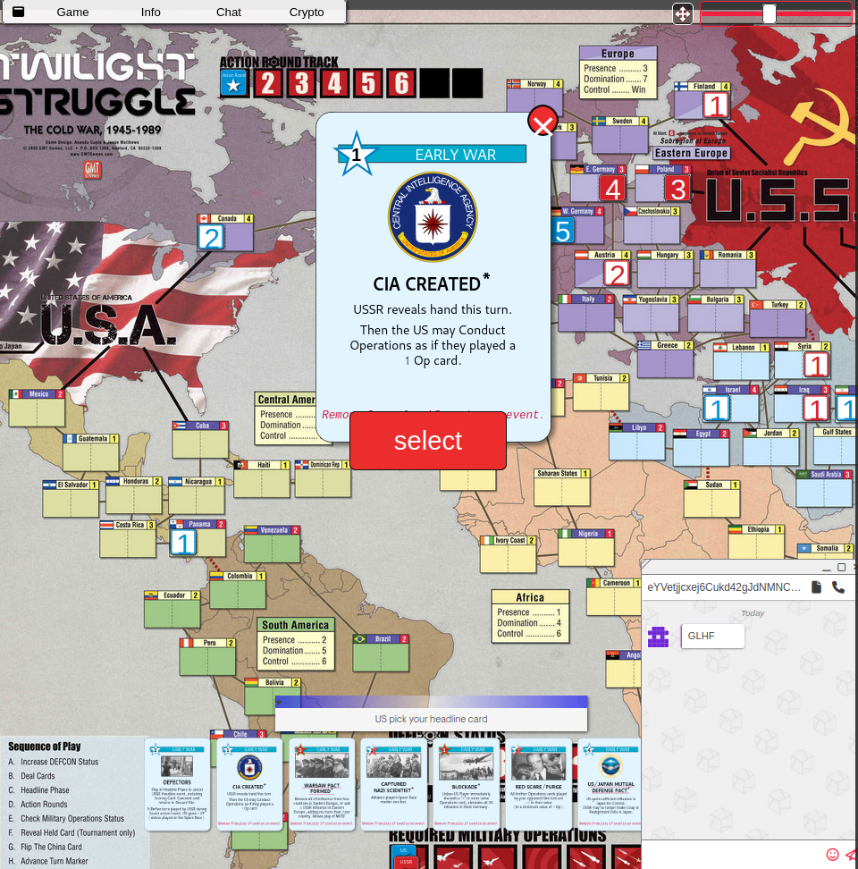

 <a href="https://mods.saito.io/twilight.saito" class="is-asset-link" style="display:inline-flex;align-items:center;gap:0.35rem;padding:0.55rem 0.9rem;border:1px solid #ccc;border-radius:6px;background:#fff;color:#333 !important;text-decoration:none;line-height:1;white-space:nowrap;"> ⬇ Download Module </a> <a href="https://github.com/SaitoTech/saito/tree/master/node/mods/twilight" style="display:inline-flex;align-items:center;gap:0.35rem;padding:0.55rem 0.9rem;border:1px solid #ccc;border-radius:6px;background:#fff;color:#333 !important;text-decoration:none;line-height:1;white-space:nowrap;"> Source Code ↗ </a> <a href="https://wiki.saito.io/applications/install" style="display:inline-flex;align-items:center;gap:0.35rem;padding:0.55rem 0.9rem;border:1px solid #ccc;border-radius:6px;background:#fff;color:#333 !important;text-decoration:none;line-height:1;white-space:nowrap;"> Installation Guide ↗ </a> 
 

# Twilight Struggle

*"Now the trumpet summons us again, not as a call to bear arms –– but a call to bear the burden of a long twilight struggle..."* - John F. Kennedy

Twilight Struggle's gained recognition for excellence within a few years of its publication in 2005, and continues to be one of the most compelling two-player boardgames ever created, with near infinite replayability and strategic challenge. The Saito edition is an open source module that runs of the Saito game engine and supports multiple playmodes, the ability [to create and use custom cards](/applications/twilight/api), and much more.

 

The game is a loose simulation of the Cold War in which one player assumes the role of the USSR and the other contains them as the US. Events occur over 10 rounds which mark the critical events of the Cold War, with a different history unfolding depending on how cards are dealt and used by each player. Will Castro take Cuba? Will the powers succumb to nuclear brinkmanship? Every game is different.

The defining mechanic of Twilight Struggle is that as players may choose to use cards for the "events" described on them, or play them for points that can be used for common operations. But the event will always occur if it favors the opponent. This create a game of crisis management as players seek to dominate regions while their own actions create vulnerabilities their opponents may exploit.

## About the Saito Edition

In addition to the standard and optional game-modes, the Saito Edition of Twilight Struggle supports a number of custom game modes and the ability to create [custom cards](/applications/twilight/api) which can enter gameplay and change the strategic balance of the game. If you're an experienced player looking for something new we'd suggest giving the Saito Edition a try.

It would be remiss not to mention that the Saito Edition of Twilight Struggle is released under an open source license provided by GMT Games, which requires that one player in every game has purchased a copy. We kindly remind players to reward the company for their generosity and open-mindedness by purchasing a copy [here](https://www.amazon.com/GMT-Games-Twilight-Struggle-Deluxe/dp/B0060L6EE4).
